#+title: 用 C++ 从零实现大模型 - 第一部分：分词
#+date: 2026/09/14
#+author: Donkey <anjingyu_ws@foxmail.com>

** 楔子

过去几个月我经常使用 ~Claude~ ，无论是工作中，还是用来探讨诸如我们是否身处模拟世界、人工智能伦理之类的话题，或是其他各种内容。
鉴于我对它的使用频率如此之高，我意识到自己对其背后的运作原理以及 ~Transformer~ 架构的真正运作方式并没有全面的了解。
基于这一情况，我决定开展几个项目，帮助自己进一步了解当前的机器学习模型。
第一个项目是用 ~C++~ 从零重建 ~LLM(QWen/GPT/DeepSeek)~ 模型。需要说明的是，我指的不只是搭建一个架构基本相同的模型，而是希望能够加载 LLM 的权重，
并且对于任意给定的输入文本，都能得到与从 ~Hugging Face Transformers~ 库中加载的模型相同的输出结果。

尽管目前已经有许多从零实现 LLM 的优质文章，但学习新事物的过程之一，是看自己能否向他人解释清楚。
只有做到这一点，我才觉得自己真正理解了它。基于这个想法，我打算写一系列文章来梳理我的实现过程，希望在这个过程中既能帮助自己，也能帮到其他人。
我通常会从非常技术化的角度来处理问题，说实话，很多关于注意力机制（键、查询等）的解释都没能真正帮我理解其背后的原理，所以我会尝试用更符合我理解逻辑的方式来呈现内容。

一起从 ~GPT2~ 这个 *古早* 模型开始，以下是 ~GPT2~ 架构的高层示意图，从输入字符串一直到下一个标记的概率分布：

试图在一篇博客文章里把整个过程讲清楚或许有些过于雄心勃勃了，所以我会把它拆分成几个部分。这第一部分将只讲解分词流程，也就是从输入字符串（原始文本）到输入标记（整数向量）这一链条的第一步。我计划在接下来几周内完成剩余部分的讲解，不过具体进度如何还有待观察。

~C++~ 实现的所有代码，包括验证其与 ~Python~ 版本一致的测试，都已在我的[[https://github.com/daoplays/transformer][GitHub 仓库]]提供。
我会在撰写这些文章的过程中对代码进行整理并添加注释，因此尽管目前代码已全部可用，但部分内容的文档可能还不够完善。

** GPT-2 分词流程

在开始编写任何代码之前，梳理一个具体示例来说明分词过程具体是如何运作的，可能会很有帮助。原则上，实现分词的方法有很多，例如：
1. 基于单词的分词，以空格和标点作为分割依据。这种方法虽简单，但对于分词器词汇表中不存在的单词处理效果不佳；
2. 基于字符的分词，将每个字符作为分割单位。这种方式能处理任意文本序列，但效率低下，且会产生大量的分词。

~GPT2~ 的分词过程力求在这两者之间取得平衡，既能处理任意文本，又比单纯对每个字符进行分词的效率更高。
下面我们用示例句子来拆解一下："GPT2 was created by OpenAI"。

** 步骤1：初始拆分

首先发生的是，分词器会使用一个极其糟糕的正则表达式（regular expression）将输入内容拆分成更易处理的小块，同时保留重要的语言特征：

#+begin_src python
  's|'t|'re|'ve|'m|'ll|'d| ?[a-zA-Z]+| ?[0-9]+| ?[^\s\w]+|\s+(?!\S)|\s+
#+end_src

- 该模式使用竖线（`|`）符号分隔不同的匹配规则，并按从左到右的顺序依次尝试。
- 拆分顺序：
   * 常见英语缩写形式（'s、't、're、've、'm、'll、'd）
   * 单词（字母序列），前面可带有一个空格
   * 数字，前面可带有一个空格
   * 非空格非单词字符（如标点符号），前面可带一个空格
   * 各类空白字符
- 该模式是贪婪的，在进入下一个规则之前，会为每个规则匹配尽可能最长的字符串
- 单词、数字和标点符号前的可选空格允许在跟踪单词边界的同时分隔元素。
- 最后两个部分处理不同类型的空白，确保所有间距都被正确捕获和标记化。

将此正则表达式应用于我们的示例字符串，会得到以下子字符串集合：

#+begin_src python
  ["GPT2", " was", " created", " by", " OpenAI"]
#+end_src

#+begin_note
在 ~GPT-2~ 的分词器中，空格由 'Ġ'（Unicode 编码 U+0120）表示，本示例其余部分将使用该符号。
#+end_note

** 步骤2：字节对编码（BPE）

每个标记随后都会进行字节对编码。不过在讲解这个示例之前，我们需要先了解两个重要概念——词汇表和合并列表。这两者都是分词器训练过程的产物，会在输入文本的分词过程中被使用。

*** 词汇

GPT2 的词汇表存储在一个 JSON 文件中，该文件将 50257 个标记映射到其对应的唯一整数 ID。它包含单个字符、常见子词和高频单词。以下是几个具体示例：

#+begin_src json
  {
    "!": 0,
    """: 1,
    ...
    "ĠThe": 383,
    ...
    "The": 464,
    ...
    "the": 1169,
    ...
    "<|endoftext|>": 50256
  }
#+end_src

请注意，大小写以及前面是否有空格都很重要！在 GPT2 词汇表中，“The”、“the” 和 “ The” 都被视为不同的标记。

*** 合并

在字节对编码过程中，我们可以执行50,000种可能的合并操作。列表中的每一项都代表一次合并操作，标明了哪些标记对需要合并。合并的顺序至关重要——它体现了合并的优先级。列表中靠前的几项合并操作如下所示：

#+begin_src
  Ġ t
  Ġ a
  h e
  i n
  r e
  o n
  Ġt he
#+end_src

这两个概念——词汇表（vocab）和合并列表（merge list）——联系紧密，且均源自同一生成过程。如果你好奇为何词汇表的条目数（257个）比合并列表略多，原因在于词汇表包含了对应所有可能字节（0-255）的256个条目，同时还收录了ID为50256的特殊“文本结束”符号。这些条目并非由合并操作生成，而是为了确保任意字节序列都能被分词而纳入其中。合并列表决定了分词过程中字符和子词的组合方式，而这些合并操作生成的分词结果则收录在词汇表中。

